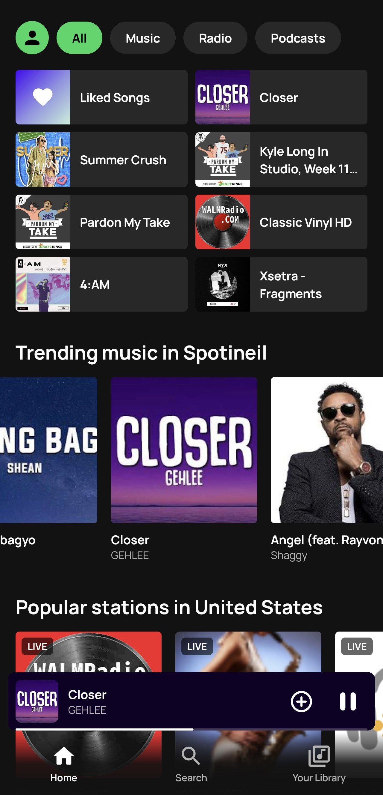
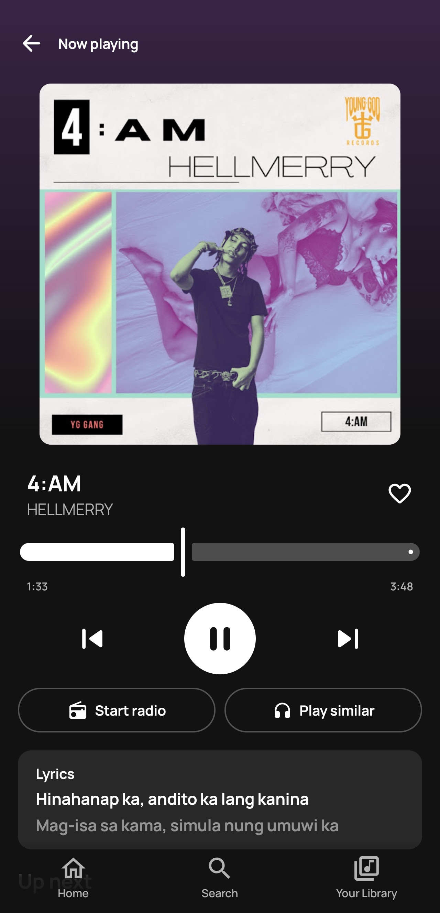
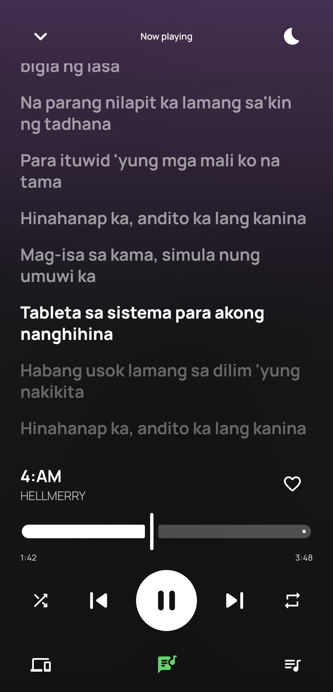

# Spotineil

A free Android music app, written in Kotlin with Jetpack Compose (Material 3). It opens straight into music: **no account, no sign-in, no ads.**

[**Download the latest version**](https://github.com/freshmens12/Spotineil/releases/latest) · [Privacy](docs/PRIVACY.md) · [License: GPL-3.0](LICENSE)

## Install on your phone

1. On your phone, open the [latest release](https://github.com/freshmens12/Spotineil/releases/latest) and download **Spotineil.apk**.
2. Open the downloaded file. If Android asks, allow **Install unknown apps** for your browser or Files app.
3. Tap **Install**, then open **Spotineil**. Android 10 or newer is required.

> Google Play Protect may show "App scan recommended" because the app isn't from the Play Store. Tap **More details → Install without scanning**.

**Updates:** every time the app opens it checks this repository's latest release. If there is a newer version it asks you, and only downloads and installs it when you tap **Update**. Updates install over the app only if they are signed with the same key as the version you have, so always take updates from this page.

**Had Spotineil 1.14.0 or older?** From 1.15.0 on, releases are signed with Spotineil's own key instead of a developer key, so 1.15.0 installs as a new app next to the old one. It explains the move when you open it: in the old app, **Settings → Backup & restore → Back up**; in the new one, **Restore** that file; then uninstall the old app. This is needed only once.

## Screenshots

<table>
  <tr>
    <td align="center"><br><sub>Home</sub></td>
    <td align="center"><br><sub>Player</sub></td>
    <td align="center"><br><sub>Synced lyrics</sub></td>
  </tr>
</table>

## What you get

| | |
|---|---|
| **Music** | Full-length songs from YouTube Music: trending music, search, charts, artist and album pages, moods and genres, made-for-you shelves, Spotineil Wrapped, **Start radio**, **Play similar**, autoplay, and **Continue listening**. Audio only, with the screen off. |
| **More free music** | Independent artists on Audius and Jamendo, Creative Commons remixes on ccMixter, and live concerts and free albums from the Internet Archive. |
| **Radio and podcasts** | Thousands of live radio stations (Radio Browser) and the Apple Podcasts directory, with episodes from each show's own RSS feed. |
| **Your library** | Your own playlists (create, reorder, rename), Downloads, Backup & restore, Liked Songs, History of every song you played, recent searches, songs that continue where you left them, followed podcasts, saved stations, and the music files on your phone, which you can also delete from inside the app. All stored on the phone. |
| **Lyrics** | Synced, line-by-line lyrics from LRCLIB, translated lyrics, lyrics downloads (.lrc or .txt), karaoke mode with AI "vocals off" (the singer's voice removed on the phone), and lyric lines shared as pictures. |
| **Player** | Full player screen, mini player, queue, sleep timer, output-device picker (Bluetooth, wired, cast), notification, lock-screen and Bluetooth controls, Android Auto browsing. |
| **Widgets** | Six home-screen widgets: **Your playlists** (tap to shuffle), **Player** (2×2), **Now playing** (4×1), **Mini player** (2×1), **Quick actions** (4×1) and **Recently played** (4×2). Long-press your Home screen, tap Widgets and pick Spotineil. |
| **Themes and language** | System, Light, Dark, AMOLED black and **Soft glass**; 8 accent colours; English, Spanish and Tagalog (or Automatic). |
| **Spotify (optional)** | Connect your Spotify account to see private playlists and Liked Songs; songs are played from YouTube Music. |
| **Sound** | Crossfade or AutoMix between songs (gapless within an album), equalizer with presets, volume leveling, skip silence, podcast speed, sleep timer that fades out. |
| **Downloads** | Save songs to Music/Spotineil to play without internet in any music player. YouTube songs are saved as they are streamed (.opus or .m4a, no re-encoding) or converted to MP3 or M4A, with the song and artist written in; several download at once, with progress in Library → Downloads, and they continue after a lost connection; free-catalog songs can be saved when their artist or licence allows it. |

## What Spotineil does *not* do

Spotineil does not block ads. Its Download button saves YouTube songs as audio files on your phone; YouTube’s terms do not allow downloading except where YouTube offers it, so only download for your own personal listening. It is an independent, unofficial project: it is **not affiliated with, endorsed or sponsored by YouTube, Google, Spotify or any music service**, and all music, artwork and lyrics belong to their artists and rights holders. Accessing YouTube Music this way is not something Google officially supports, and Google's terms may restrict it, so use it for personal listening and at your own risk.

## Build it yourself

You need **JDK 21** (for example [Temurin 21](https://adoptium.net)) and the Android SDK (platform 37). Android Studio's bundled JDK 17 cannot build the project.

```bash
./gradlew assembleDebug          # build the APK  → app/build/outputs/apk/debug/app-debug.apk
./gradlew assembleRelease        # optimized (R8) build → app/build/outputs/apk/release/ (unsigned without a keystore)
./gradlew installDebug           # install on a connected phone
./gradlew testDebugUnitTest      # unit tests + Robolectric Compose UI tests
```

### Optional API keys

Two features use free third-party keys. Without them the app still builds and runs; those features are just hidden or limited. Put your own keys in `local.properties` in the project root. **That file is git-ignored; never commit it.**

```properties
sdk.dir=/path/to/Android/sdk
LASTFM_API_KEY=your_lastfm_api_key         # https://www.last.fm/api/account/create (similar artists for radio and Play similar)
JAMENDO_CLIENT_ID=your_jamendo_client_id   # https://devportal.jamendo.com (the Jamendo shelf)
```

CI and other machines can use environment variables with the same names.

### About keys and security

- **No key, password or keystore is stored in this repository or its history.** `local.properties`, keystores and built APKs are git-ignored.
- Any key an app needs at run time ends up inside its APK, and anyone can extract it from there. That is true of every Android app. For this reason only low-risk, free keys are used (a Last.fm API key and a Jamendo client id: no billing, no secret, no account access), and the downloads on the Releases page are built with the maintainer's keys. If you fork the project, use your own.
- The code still contains an optional, now hidden Spotify mode (App Remote and Web API). It is not reachable from the app's screens, and building it needs a `SPOTIFY_CLIENT_ID` in `local.properties`.

## Publishing a release (maintainers)

1. Raise `versionCode` and `versionName` in `app/build.gradle.kts` and run `./gradlew assembleRelease`.
2. Run `scripts/publish-release.sh <version> app/build/outputs/apk/release/app-release.apk "what's new"`. It creates the GitHub release on this repository and uploads the APK as `Spotineil.apk`, using the GitHub sign-in git already has.
3. Phones with an older version offer the update the next time the app opens.

Release builds are signed with the project's release keystore. It is kept outside the repository, and the build reads its location and passwords from `local.properties` (or environment variables):

```properties
SPOTINEIL_KEYSTORE_PATH=/path/to/spotineil-release.jks
SPOTINEIL_KEYSTORE_PASSWORD=…
SPOTINEIL_KEY_ALIAS=spotineil
SPOTINEIL_KEY_PASSWORD=…
```

Updates only install over an existing app if they are signed with the same key, so **keep at least two backups of the keystore and its password** off the build machine. Losing it means every user has to uninstall and reinstall to get new versions.

## Architecture

MVVM + Clean Architecture, split into Gradle modules:

```
:app                 Navigation, DI wiring, theming, in-app updater, home-screen widgets (Glance)
:core:model          Plain Kotlin domain models
:core:common         Dispatchers, application scope, shared config
:core:network        Retrofit / OkHttp and kotlinx.serialization (LRCLIB, and the optional Spotify mode)
:core:data           Repositories, the YouTube Music catalog (InnerTube X), free-source clients,
                     Room cache, DataStore settings, LRC parser
:core:player         PlaybackController over Media3 (ExoPlayer + MediaLibraryService), stream routing
:core:designsystem   Themes (incl. Soft glass), Manrope font, shared Compose components
:core:ui             Shared feature UI (track menu)
:core:testing        Test fakes and rules
:feature:discover    The free app: Home, Search, Library, YouTube player, History, details
:feature:player | settings | library | home | search | album | artist | playlist | profile
```

- **DI:** Hilt. **Async:** Coroutines and Flow. **Images:** Coil. **Navigation:** Compose Navigation with type-safe routes.
- **Build:** Gradle Kotlin DSL, a version catalog (`gradle/libs.versions.toml`), convention plugins in `build-logic/`.
- **Offline-first:** Room caches song lists, charts, lyrics and recent searches; screens show cached data first, then refresh.

### How a song plays

```
Search / Home / widget ──► FreePlayer ──► PlaybackController ──► LocalEngine (Media3)
                                                                       │
              ytmusic://video/<id>  ──►  RoutingDataSource ──► InnerTube X resolves the audio stream
              any other address     ──►  the normal data source (radio, podcasts, local files, …)
```

## Testing

Unit tests cover the network layer, repositories, the LRC parser, song ranking and radio mixing, the in-app updater's version logic, and the view models. Compose UI tests run on Robolectric, so CI needs no emulator.

```bash
./gradlew testDebugUnitTest
```

`.github/workflows/ci.yml` builds the debug APK and runs all tests on every push and pull request. A second job starts the app on an Android emulator and runs the device smoke tests in `app/src/androidTest` (main screens open, a sound plays through the real player). Run them yourself with `./gradlew connectedDebugAndroidTest` while a phone or emulator is connected.

## Credits and license

Spotineil is free software under the [GNU General Public License v3.0](LICENSE). Copyright (c) 2026 The Spotineil contributors. You may use, study, share and change it; anyone you give a copy to must also be able to get its source code under the same license.

It is built on [InnerTube X](https://github.com/MetrolistGroup/innertubex) (GPL-3.0), which is why the whole app is GPL-3.0, and on many open-source libraries and free services. The full list, with licenses, is in the app under **Settings → Open-source licenses**. The Manrope font is under the SIL Open Font License 1.1.
